<div align="center">

# talking-head-pipeline

**Record yourself talking. Your AI agent turns the raw take into a clean, dynamic, finished video.**

[](LICENSE)
[](#install)
[](#install)
[](https://www.remotion.dev)


</div>

Two agent skills and the tools behind them:

- **`/autocut`** measures your audio/video sync from your lips, transcribes every word twice (once
  for timing, once verbatim so no stumble hides), cuts silences, false starts and restarts, renders
  with intact word edges, then re-transcribes the cut to prove it is clean.
- **`/dynamic-edit`** reads the transcript like an editor and plans punch-ins, side cards, screen
  walkthroughs, hero words behind you, 3D type and logos, captions and sound, each tied to the word
  it lands on. You approve a table; it builds, QAs and delivers.

It is opinionated on purpose. The rules it follows (face first, no one-word punches, nothing on your
face, verify every number, subtle sound) are written down in [docs/STYLE_RULES.md](docs/STYLE_RULES.md)
and enforced by the scripts where they can be.

## How it works

```mermaid
flowchart TD
    RAW["Raw recording<br/>(any camera or screen recorder)"] --> AC

    subgraph AC ["/autocut"]
        direction TB
        S1["Sync from lips<br/>SyncNet offset, measured per file"] --> S2["Transcribe<br/>Whisper + forced aligner"]
        S2 --> S3["Verbatim pass<br/>CrisperWhisper: stumbles, restarts, fillers"]
        S3 --> S4["Plan: silences, retakes, keep ranges"]
        S4 --> G1{"Human approves<br/>the cut plan"}
        G1 -->|edits| S4
        G1 -->|go| S5["Render clean cut<br/>edges snapped to the waveform, CFR"]
        S5 --> S6["Re-verify<br/>verbatim transcript OF the cut,<br/>removed-span audit, edge scan"]
    end

    S6 --> CLEAN["clean.mp4 + verbatim words"] --> DE

    subgraph DE ["/dynamic-edit"]
        direction TB
        D1["Track face, detect cuts"] --> D2["Plan beats with word anchors<br/>why / in-word / out-word"]
        D2 --> G2{"Human approves<br/>the edit plan"}
        G2 -->|edits| D2
        G2 -->|go| D3["Layouts<br/>talking head / side card / screen scene"]
        D3 --> D4["3D hero type + 3D assets<br/>path-traced PNG frames"]
        D4 --> D5["Roto / matte<br/>words and objects pass behind you"]
        D5 --> D6["Captions<br/>fixed band, phrase emphasis"]
        D6 --> D7["SFX tied to visible events"]
        D7 --> D8["Render with Remotion + QA gates"]
    end

    D8 --> SYNC["Sync trim<br/>measure render audio delay, trim it"]
    SYNC --> FINAL["Final video"]
```



## Features

**Cutting**
- Lip-sync offset measured per file (wireless mics drift by session); never a hardcoded number
- Word edges re-timed by a forced aligner, then every cut edge snapped to real silence (-55 dB)
- Verbatim second transcription finds the repeats and false starts regular Whisper smooths away
- Restart detection (a phrase said, abandoned, said again), keep-the-last-take by default
- Plan gate: a readable table of every cut before anything renders
- Self-check: removed-span audit for leftover speech, verbatim transcript of the cut, clipped-onset
  scan, silent-sliver removal, constant frame rate

**Editing (Remotion)**
- Punch-ins anchored on the tracked face, chosen from the transcript, easing at both ends
- **Side layout**: you slide to one side, content-sized cards on the other (stat, list, compare, image)
- **Screen scene**: a browser window with your page, camera shrinking into a picture-in-picture,
  animated cursor, word-anchored zooms
- **Roto**: hero words and objects passing behind you (matte PNG sequence)
- **3D hero type** from any font and **3D logos / medallions** from any SVG, path-traced to
  transparent frames (`tools/render3d`)
- Full-screen scenes: 2.5D depth (three.js), pre-rendered clips, code-built stages with real zooms
  and an edge fade that never slices text under the captions
- Captions with consistent safe zones per layout and phrase-level emphasis
- SFX placed on visible events at their measured peak; patch renders for post-delivery fixes
- One engine for 16:9 and 9:16, picked from the plan

## Install

```bash
git clone <this repo> talking-head-pipeline && cd talking-head-pipeline
./install.sh --dry-run     # see what it will do
./install.sh               # links skills into ~/.claude/skills, records THP_HOME, checks tools
```

- **Claude Code**: restart it; `/autocut` and `/dynamic-edit` are available.
- **Codex**: add the lines `install.sh` prints to `~/.codex/AGENTS.md` (or your project's
  `AGENTS.md`), pointing Codex at the two `SKILL.md` files.
- Any other shell-capable agent: give it `docs/AGENT_GUIDE.md` and the two `SKILL.md` files.

## Quickstart (5 minutes)

1. Install the system tools (ffmpeg, Python 3.10+, uv, Node 20+): [docs/SETUP.md](docs/SETUP.md).
2. `./install.sh`, then once: `scripts/sync/setup_syncnet.sh` (lip-sync detector, ~145 MB).
3. Record a 1-2 minute take, looking at the camera. Stumble on purpose once.
4. In Claude Code (or Codex), say:
   > autocut ~/Videos/take-01.mp4
5. Read the plan table it shows you, answer "go".
6. When `clean.mp4` opens, say:
   > make it dynamic. 16:9 for YouTube.
7. Approve the edit plan. Get coffee. Watch the final.

First runs download models (a few GB in total). Later runs start in seconds.

## Examples

> Add your own here: before/after clips, a plan table, stills of each layout.

| Layout | What to show | Your clip |
|---|---|---|
| Talking head | a sentence-long punch landing on its word | *add `docs/images/talking-head.jpg`* |
| Side | a card punching on the number being said | *add `docs/images/side.jpg`* |
| Screen scene | browser + camera PiP + cursor zoom | *add `docs/images/screen.jpg`* |
| 3D hero | extruded type beside the head | *add `docs/images/hero3d.jpg`* |
| Before / after | raw take vs final, same 20 s | *link a video* |

## Requirements

| | Minimum | Notes |
|---|---|---|
| OS | macOS 13+ or Linux (x86_64/arm64) | Windows via WSL2 |
| CPU/GPU | Apple Silicon, or any CPU; NVIDIA optional | GPU speeds up Whisper, SyncNet, matting, 3D |
| RAM | 16 GB | 32 GB comfortable for long takes |
| Disk | ~10 GB free | model caches + matte frames during a project |
| ffmpeg | 5+ with libx264 | |
| Python | 3.10+ (3.11 for the project venv) | MediaPipe has no wheels past 3.12 |
| Node | 20+ | Remotion 4, puppeteer |
| uv | any recent | runs each model in its own throwaway env |
| Whisper | mlx-whisper (Apple Silicon) / faster-whisper (elsewhere) | automatic |

## Repository layout

```
skills/autocut/SKILL.md            the cut skill (what the agent follows)
skills/dynamic-edit/SKILL.md       the edit skill + references/ (plan schema, QA gates, effect numbers)
scripts/autocut/                   autocut.py and its stages (cut, snap, audit, QA, whisper backend)
scripts/align/                     forced aligner, retake / stumble finders
scripts/sync/                      SyncNet setup + lip-sync detection, manual clap measure
scripts/master/sync_trim.sh        final render audio-delay trim (+ optional loudness)
template/                          Remotion project + per-project scripts (track, matte, cues, plan, SFX, render, patch)
tools/render3d/                    path-traced 3D type and logos to transparent PNG frames
docs/                              SETUP, AGENT_GUIDE, STYLE_RULES, LAYOUTS, 3D
```

## FAQ

**Do I need to know how to code?** No. You talk to your agent; it runs everything and shows you
tables and videos. You need to be able to install the system tools once.

**Does it upload my footage anywhere?** No. Every model runs locally. Nothing in the pipeline calls a
cloud API (your agent itself is whatever you run it with).

**Which languages?** Transcription works in every Whisper language. Word re-timing is benchmarked
for English and Portuguese, and works for Italian, Spanish, French, German and Dutch (verify once).
Adding a language is one line in `scripts/align/align_words.py`.

**Can I skip the lip-sync step?** Yes: `--offset <seconds>` if you know it, `--no-sync` for footage
without a face. But measure at least once: most wireless setups are off by 100-300 ms.

**Why two transcriptions?** Regular Whisper is great at timing and terrible at admitting you said a
phrase twice: it returns the clean sentence. CrisperWhisper's verbatim mode keeps every stumble. The
pipeline uses the first for timing and the second to find and verify cuts.

**Vertical shorts from a horizontal recording?** Yes. Record at 2560x1440 if you can; a static 9:16
crop centred on your median head position is made automatically (`prep_vertical.sh`).

**Can I change the look?** `template/remotion/src/lib/theme.ts` (colours, font, curves),
`lib/fontPairings.ts` (captions), `layouts/cards.tsx` (card kinds), `screen/pages.tsx` (screen
content). The rules in STYLE_RULES.md are the part we suggest you keep.

**Where do sound effects come from?** You bring them (free sources in SETUP.md). None ship here.

**Is the 3D real 3D?** It is a real path tracer (GGX metal, area-ish studio lighting, motion blur,
depth of field) running in WebGL2 in headless Chrome, rendering extruded signed-distance fields of
your text or logo. No 3D package needed.

## License

Code: [MIT](LICENSE).

**Remotion is not MIT.** The template depends on [Remotion](https://www.remotion.dev), which is free
for individuals and companies up to 3 employees and requires a paid company license above that. Read
[remotion.dev/license](https://www.remotion.dev/license) before using the template commercially.

Third-party models and tools are downloaded from their sources and keep their own licenses:
SyncNet ([joonson/syncnet_python](https://github.com/joonson/syncnet_python), MIT), Whisper
(MIT), mlx-whisper (MIT), faster-whisper (MIT), WhisperX (BSD-2), CrisperWhisper (**CC BY-NC 4.0: non-commercial**, see below), MediaPipe (Apache-2.0), backgroundremover / U2-Net (MIT / Apache-2.0),
Google Fonts (mostly SIL OFL). Check each before commercial use. Sound effects and fonts you add are
under their own licenses.

> **Commercial use and CrisperWhisper.** The verbatim pass (stumble detection and the final cut
> check) uses the CrisperWhisper weights, which are licensed CC BY-NC 4.0. If your videos are
> commercial, get a license from its authors or swap the verbatim backend
> (`scripts/align/backends/crisperwhisper_align.py`) for a model whose terms fit. The rest of the
> pipeline does not depend on it.
